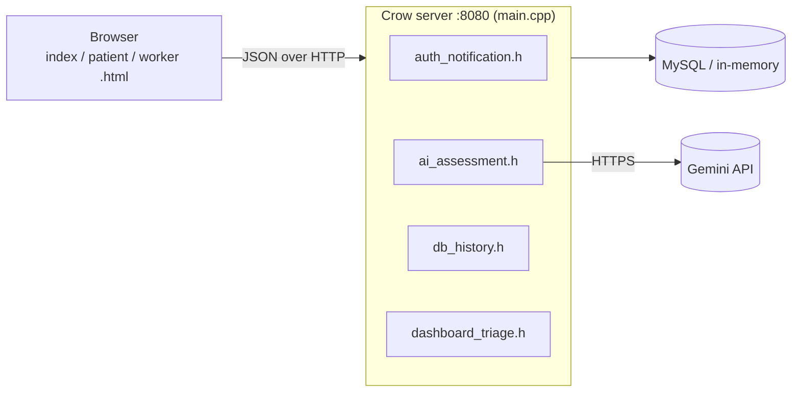

# Medico — Project Documentation

Medico is an AI-assisted screening and triage tool for community health.
Patients describe their symptoms and lifestyle, Google Gemini estimates
their chronic-disease risk, and ASHA workers see patients in their own area
ranked by that risk.
Setup steps are in [README.md](README.md).

> Medico is a triage aid, not a diagnostic device. Every AI result needs
> follow-up by a clinician.

---

## 1. Features

### Patient
| Feature | Details |
|---------|---------|
| Sign up / login | Email, password, name, phone, village/area, age, gender. Returns a session token (`sess_` + 32 characters), stored in `localStorage`. |
| New assessment | Checklist of symptoms in 5 body systems (cardiovascular, metabolic, respiratory/neurological, digestive/kidney/liver, musculoskeletal), plus duration, severity, family history, lifestyle and free-text notes. No vitals are entered. |
| AI report | Risk score (0–100), risk level (Low/Moderate/High/Critical), possible diseases, recommended specialist, symptoms to watch, precautions, immediate actions. |
| History | Past assessments, newest first, each with a **View Report** button. |
| Alerts | Sidebar showing alerts sent by the ASHA worker. Refreshes every 8 s. Also lists emergency numbers (108, 104, 112). |

### ASHA Worker
| Feature | Details |
|---------|---------|
| Area scoping | Shows only patients whose `village_area` matches the worker's. Matching ignores case and extra spaces. |
| KPIs | Total screenings, number of Critical cases, number of high-risk cases (score > 80), alerts sent. |
| Triage table | Sorted by risk score, highest first. Shows patient, primary symptom, specialist, status. |
| Actions | **Alert** (asks for confirmation, then appears on the patient's page), **Contact** (shows phone and area), **Report** (opens the full report). |

### Common
- Page guards redirect a user who isn't logged in, or is on the wrong role's page.
- A `401` response clears the saved session and returns the user to login.

---

## 2. Tech Stack

| Layer | Technology | Reason / trade-off |
|-------|------------|--------------------|
| Backend | C++17 + [Crow](https://crowcpp.org/) | Flask-style routing and multithreading, with no extra runtime. Needs more code than Python/Node. |
| JSON | nlohmann/json | Standard C++ JSON library. |
| AI | Google Gemini `generateContent` (free tier) | Returns structured JSON (`temperature 0.2`, JSON response mode). |
| HTTPS client | WinHTTP | No OpenSSL/libcurl needed, but the backend only runs on Windows. |
| Database | MySQL 8.0 (C API) + in-memory fallback | The app still works when MySQL isn't installed. |
| Frontend | HTML, CSS, vanilla JS | No build step. UI is built with `innerHTML`, so escaping matters. |
| Build / config | g++ (MinGW-w64), `build.bat` / `run.bat`, `.env` | Secrets stay out of git. |

The Crow, Asio and nlohmann/json headers go in `backend/include/`. This
folder is git-ignored, so each developer downloads them separately.

---

## 3. Architecture

- The server serves the static frontend and the `/api/*` JSON routes.
- Each backend header pairs with a frontend script of the same name
  (`ai_assessment.h` ↔ `ai_assessment.js`).

**Assessment flow** (`POST /api/assessments`):
1. The server builds a prompt from age, gender, symptoms and history.
2. It calls Gemini, trying models in order: `gemini-flash-lite-latest` →
   `gemini-2.5-flash-lite` → `gemini-2.5-flash`.
   - `429` (quota used up): skip to the next model.
   - `503` or no response: retry the same model once after an 800 ms
     backoff, then move on.
   - Any other error: move on.
3. It strips any code fences from the reply, parses the JSON, and saves the
   result. The client gets `201` with the assessment.
4. If every model fails, the client gets `503`. There is no offline
   fallback, so the server never invents a score.

---

## 4. Data Model

Both tables are created automatically at startup.

| Table | Key columns |
|-------|-------------|
| `users` | `id`, `username` (email, unique), `password_hash`, `role` (`patient` \| `asha_worker`), `full_name`, `phone`, `village_area`, `age`, `gender`, `created_at` |
| `assessments` | Patient details copied at submission time; `symptoms_text`, `medical_history`; AI output (`risk_score`, `risk_level`, `recommended_doctor`, `immediate_actions`, and JSON-string lists `possible_chronic_diseases`, `other_symptoms_to_watch`, `precautions`); ASHA fields (`alert_sent`, `alert_sent_at`, `alert_message`, `asha_contacted`, `asha_notes`); legacy vitals columns, always stored as `0` |

---

## 5. Programming Concepts Demonstrated

| Concept | Location |
|---------|----------|
| Inheritance and polymorphism | `models.h`: `Person` → `Patient` / `AshaWorker`, with virtual `role_description()` |
| Binary max-heap (heapsort) | `db_history.h`: `AssessmentMaxHeap` ranks in-memory assessments by risk. MySQL mode uses `ORDER BY` instead. |
| Thread safety | `std::mutex` in `DatabaseManager` and `AuthSessionManager` |
| Custom exceptions | `GeminiOverloadedError` and `GeminiQuotaExhaustedError` choose the retry behavior |
| Modular routing | Each module has its own `register_*_routes()` |

---

## 6. API

| Method | Route | Auth | Purpose |
|--------|-------|------|---------|
| POST | `/api/auth/register` | — | Create an account and get a token |
| POST | `/api/auth/login` | — | Log in and get a token |
| GET | `/api/auth/me` | Bearer | Get the current user |
| POST | `/api/auth/logout` | Bearer | End the session |
| POST | `/api/assessments` | — | Run an AI assessment and save it |
| GET | `/api/assessments/my?patient_id=` | — | Get a patient's history |
| GET | `/api/worker/assessments` | ASHA | Get the risk-sorted triage list and KPIs for the worker's area |
| GET | `/api/worker/assessments/search?q=` | ASHA | O(1) patient search via Hash Table with Separate Chaining |
| POST | `/api/worker/assessments/<id>/alert` | ASHA, same area | Send an alert |
| POST | `/api/worker/assessments/<id>/contact` | ASHA, same area | Log outreach notes |
| GET | `/api/lab/catalog` | — | Diagnostic test catalog and preparation guidelines |
| GET | `/api/lab/available-slots?date=` | — | O(log N) slot availability check via Interval Tree |
| POST | `/api/lab/book` | — | Book lab test with O(log N) overlap prevention |
| GET | `/api/lab/my-bookings?patient_id=` | — | Get scheduled lab tests for patient |
| GET | `/api/worker/lab/triage-queue` | ASHA | Phlebotomy sample queue ordered by Max-Heap Priority Queue |
| POST | `/api/worker/lab/<id>/status` | ASHA | Update sample collection status |
| GET | `/api/db/test`, `/api/health` | — | Diagnostics |

Errors are returned as `{"error": "..."}` with one of these codes:

| Code | Meaning |
|------|---------|
| `400` | Bad input |
| `401` | Not logged in |
| `403` | Wrong role, or patient outside the worker's area |
| `404` | Not found |
| `409` | Account already exists |
| `503` | AI unavailable |

---

## 7. Known Limitations

| # | Issue | Suggested fix |
|---|-------|---------------|
| 1 | Passwords are stored in plain text | Hash them with bcrypt or Argon2 |
| 2 | Patient endpoints trust the `patient_id` sent by the client, so anyone can read any patient's history | Require a token and take the patient ID from the session |
| 3 | SQL is built by string concatenation (escaped) | Use prepared statements |
| 4 | User text is inserted with `innerHTML`, a stored XSS risk | Use `textContent` or escape the text |
| 5 | Sessions are kept in memory and never expire | Persist sessions and add a time-to-live |
| 6 | `/api/db/test` returns hard-coded `PASSED` | Run real checks, or add a GoogleTest suite |
| 7 | The `/contact` endpoint isn't called by the UI, so "Contacted" is never set | Add a notes form to the Contact modal |
| 8 | Gemini's `risk_level` can disagree with `risk_score` | Work out the level from the score on the server |
| 9 | The dashboard has no search or filter; there are no profile edits or password resets | Future work |
| 10 | Runs only on Windows (WinHTTP) | Switch to libcurl |
| 11 | Patient data is sent to Google | Get consent and a DPDP Act 2023 review before real use |

**AI evaluation (not yet done):**
- Build a set of test cases reviewed by a clinician.
- Measure sensitivity on High and Critical cases.
- Check that repeated runs on the same input give consistent scores.
- Compare against a rule-based danger-sign baseline.

---

## 8. Team

| Module | Developer |
|--------|-----------|
| Auth & ASHA notifications | Yashwardhan Rohilla |
| Gemini AI & new assessment | Vivek Chamoli |
| Database, testing & history | Anjali |
| Dashboards & high-risk triage | Nandini |
